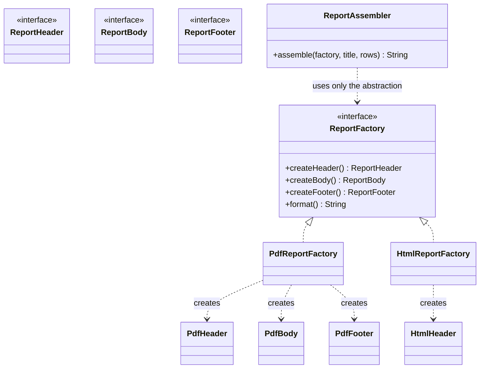

# Abstract Factory

**Category:** Creational
**Package:** `com.example.designpatterns.creational.abstractfactory`

## Intent

Provide an interface for creating families of related or dependent objects without
specifying their concrete classes.

## The problem it solves

Factory Method creates *one* product. Abstract Factory creates a *matched set* whose
members only make sense together.

A report has a header, a body and a footer. A PDF header inside an HTML document is
not a slightly-wrong report; it is a broken one. If the assembler picks each part
independently, nothing stops that mix — and the mistake is one typo away at every
call site.

Abstract Factory makes the mixing *unrepresentable*: obtain all three parts from one
factory, and they are necessarily from one family. `AbstractFactoryTest` asserts
exactly that, by checking every part reports the same `format()` as its factory.

## Structure



## Participants

| Role | Type | Location |
|---|---|---|
| Abstract Factory | `ReportFactory` | `src/main/java/com/example/designpatterns/creational/abstractfactory/ReportFactory.java` |
| Concrete Factory | `PdfReportFactory`, `HtmlReportFactory` | `src/main/java/com/example/designpatterns/creational/abstractfactory/` |
| Abstract Product | `ReportHeader`, `ReportBody`, `ReportFooter` | `src/main/java/com/example/designpatterns/creational/abstractfactory/` |
| Concrete Product | `PdfReportParts.*`, `HtmlReportParts.*` | `src/main/java/com/example/designpatterns/creational/abstractfactory/` |
| Client | `ReportAssembler` | `src/main/java/com/example/designpatterns/creational/abstractfactory/ReportAssembler.java` |

## Trade-offs — and when NOT to use it

- **Adding a product type is expensive.** A new part (say, a watermark) means
  editing the `ReportFactory` interface *and* every concrete factory. Adding a
  *family* is cheap; adding a *member* is not. Check which axis actually varies
  before choosing this pattern.
- **Class count grows multiplicatively:** families × products.
- **The families must be genuinely parallel.** If the HTML family needs a method
  the PDF family cannot support, the abstraction is wrong and you will feel it
  immediately.

**Don't use it** for a single family "in case we add more later" — that is
speculative generality, and the interface you guess today will be the wrong one.

## Where Spring uses this internally

`FactoryBean<T>` is the direct analogue. More recognisably, Spring Boot's
auto-configuration behaves like an abstract factory over infrastructure families:
choosing an embedded database, a servlet container, or a JSON mapper installs a
matched set of collaborating beans rather than one object.

## Try it

```bash
curl -s localhost:8080/api/patterns/abstractfactory | jq -r '.pdf, .html'
```

One assembler, two families, no possibility of mixing them.
