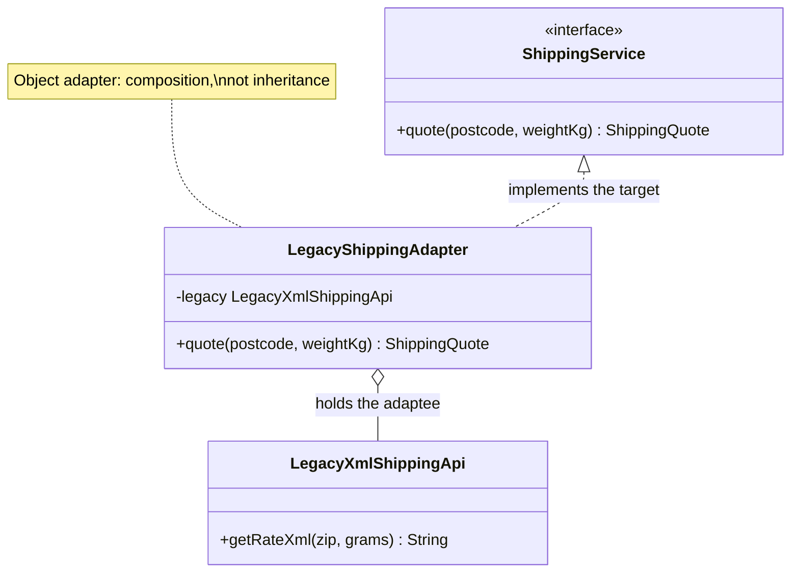

# Adapter

**Category:** Structural
**Package:** `com.example.designpatterns.structural.adapter`

## Intent

Convert the interface of a class into another interface clients expect. Adapter lets
classes work together that could not otherwise, because of incompatible interfaces.

## The problem it solves

A vendor ships you `LegacyXmlShippingApi`. It speaks **grams** and returns **a string
of XML**. Your domain speaks kilograms and typed records. You cannot change the
vendor's code.

Without an adapter, every caller parses XML and converts units. The parsing is
duplicated, the unit conversion is duplicated, and — worse — the vendor's vocabulary
spreads through your codebase. Replacing the vendor then means touching every caller.

The adapter confines all of it to one class:

```java
public ShippingQuote quote(String postcode, double weightKg) {
    int grams = (int) Math.round(weightKg * 1000);       // unit mismatch
    String xml = legacy.getRateXml(postcode, grams);     // the only call site
    return new ShippingQuote(tag(xml, "carrier"),        // format mismatch
        BigDecimal.valueOf(Long.parseLong(tag(xml, "cents")), 2),
        Integer.parseInt(tag(xml, "days")));
}
```

`AdapterTest.theAdapterIsTheOnlyPlaceThatKnowsTheLegacyTypeExists` asserts that no
legacy type appears anywhere in the `ShippingService` signature.

## Structure



## Participants

| Role | Type | Location |
|---|---|---|
| Target | `ShippingService` | `src/main/java/com/example/designpatterns/structural/adapter/ShippingService.java` |
| Adapter | `LegacyShippingAdapter` | `src/main/java/com/example/designpatterns/structural/adapter/LegacyShippingAdapter.java` |
| Adaptee | `LegacyXmlShippingApi` | `src/main/java/com/example/designpatterns/structural/adapter/LegacyXmlShippingApi.java` |
| Domain type | `ShippingQuote` (record) | `src/main/java/com/example/designpatterns/structural/adapter/ShippingQuote.java` |

## Object adapter vs. class adapter

This is an **object adapter**: it *holds* the adaptee. The alternative, a **class
adapter**, extends it. Prefer composition:

| | Object adapter (used here) | Class adapter |
|---|---|---|
| Mechanism | holds the adaptee | extends the adaptee |
| Adaptee's methods on your public surface | no | yes, all of them |
| Works with a `final` adaptee | yes | no |
| Can adapt subclasses at runtime | yes | no |

## Trade-offs — and when NOT to use it

- **Indirection.** One more hop, and one more class to keep in your head.
- **Leaky semantics.** An adapter can convert *shape* but not *meaning*. If the
  legacy API returns prices excluding tax and yours promises inclusive, no amount of
  parsing fixes it — and the mismatch will hide inside the adapter.
- **Error translation is easy to forget.** Vendor exceptions will leak through your
  clean interface unless you deliberately map them.

**Don't use it** when you own both sides. Then just change the interface. An adapter
between two things you control is usually a refactoring you have not done yet.

## Where Spring uses this internally

`HandlerMethodArgumentResolver` adapts a raw HTTP request into your controller
method's parameter types. `HttpMessageConverter` adapts a byte stream into an object
and back. `HandlerAdapter` lets DispatcherServlet invoke wildly different handler
kinds through one interface. Spring's `Jdbc`/`JPA` exception translation adapts
vendor-specific `SQLException`s into Spring's `DataAccessException` hierarchy.

## Try it

```bash
curl -s localhost:8080/api/patterns/adapter | jq
```

The response shows the same call in both vocabularies: raw XML, and the typed record.
