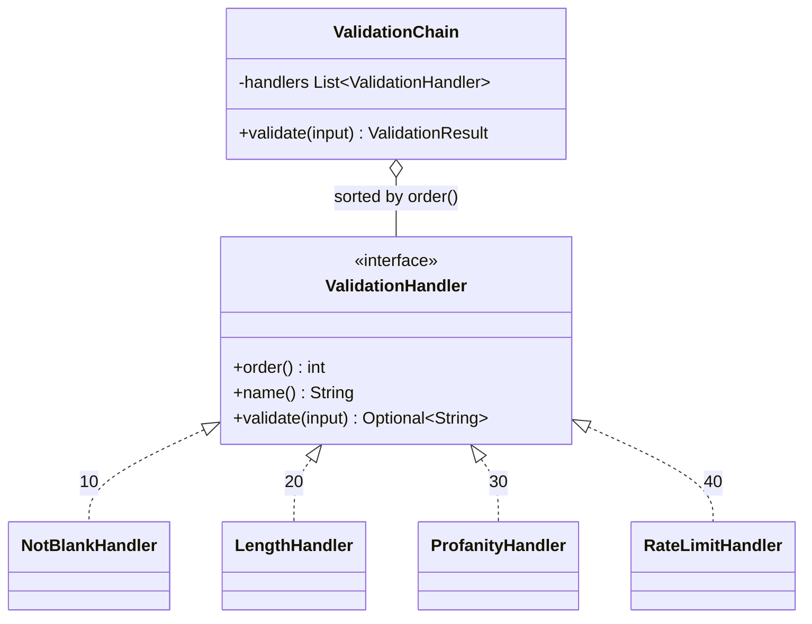

# Chain of Responsibility

**Category:** Behavioral
**Package:** `com.example.designpatterns.behavioral.chainofresponsibility`

## Intent

Avoid coupling the sender of a request to its receiver by giving more than one object
a chance to handle the request. Chain the receiving objects and pass the request along
the chain.

## The problem it solves

Validating a user comment involves several unrelated rules: not blank, within a
length window, no blocked words, within a rate limit. Written as one method it
becomes a wall of `if`s that must be edited for every new rule, where the rules'
*order* is implicit in the source and impossible to change safely.

Each rule becomes a handler that knows only its own rule:

```java
public interface ValidationHandler {
    int order();                              // lower runs earlier
    String name();
    Optional<String> validate(String input);  // empty == pass
}
```

Adding a rule is a new `@Component`. `ChainTest.addingAHandlerRequiresNoChangeToTheChainOrToExistingHandlers`
proves it by inserting a handler at order 25, between two existing ones.

## A deliberate deviation from the classic form

GoF has each handler hold a reference to its **successor**, and each decides whether
to pass the request on. That scatters the chain's shape across its links: to know
what runs after `LengthHandler` you must find whoever wired it.

This implementation gives each handler an `order()` instead, and `ValidationChain`
sorts. The trade: handlers become genuinely independent and the container can assemble
the chain from whatever beans exist, at the cost of losing per-handler control over
what happens next. `ChainTest.handlersRunInDeclaredOrderRegardlessOfInjectionOrder`
supplies the handlers deliberately backwards and asserts they still run sorted.

## Design decision: short-circuit or collect?

This project chose **collect every failure**:

```java
for (ValidationHandler handler : handlers) {
    handlersRun.add(handler.name());
    handler.validate(input).ifPresent(failures::add);
}
return new ValidationResult(failures.isEmpty(), failures, handlersRun);
```

Why: this validates user-submitted text. Reporting one problem per round trip turns
form-filling into whack-a-mole; reporting all of them lets the user fix everything at
once.

**The cost, stated honestly.** Later handlers now run on input an earlier handler has
already rejected, which has two real consequences visible in the code:

- `LengthHandler` must null-check defensively (`input == null ? 0 : …`), because it
  runs even after `NotBlankHandler` rejected a null.
- `RateLimitHandler` is stateful, so it counts submissions that were never going to
  succeed. Whether that is correct is a product decision, not a technical one.

A short-circuiting chain avoids both, at the price of the user experience above.
`ChainTest.thePolicyIsCollectAllSoEveryHandlerStillRunsAfterAFailure` asserts
`handlersRun` contains all four handlers even for blank input — nothing stopped early.

## Structure



## Participants

| Role | Type | Location |
|---|---|---|
| Handler | `ValidationHandler` | `src/main/java/com/example/designpatterns/behavioral/chainofresponsibility/ValidationHandler.java` |
| Concrete Handlers | `NotBlankHandler`, `LengthHandler`, `ProfanityHandler`, `RateLimitHandler` | `src/main/java/com/example/designpatterns/behavioral/chainofresponsibility/` |
| Chain | `ValidationChain` | `src/main/java/com/example/designpatterns/behavioral/chainofresponsibility/ValidationChain.java` |
| Result | `ValidationResult` (record) | `src/main/java/com/example/designpatterns/behavioral/chainofresponsibility/ValidationResult.java` |

## Trade-offs — and when NOT to use it

- **No handler may handle the request.** The classic form can fall off the end of the
  chain silently. Here the chain always returns a result, which sidesteps it.
- **Order is a hidden dependency.** `order()` values are magic numbers, and inserting
  a handler at 25 requires knowing 20 and 30 exist.
- **Debugging means tracing a traversal**, not reading a method. This is why
  `handlersRun` exists — without it, "did it stop early?" is unanswerable.

**Don't use it** when exactly one handler can ever apply and you know which — that is
a `Map` lookup or a Strategy. And do not use it for a fixed two-step sequence.

## Where Spring uses this internally

Servlet `Filter` chains and Spring's `HandlerInterceptor` are chains of
responsibility with the classic pass-it-on semantics (`chain.doFilter(...)` is the
explicit hand-off). Spring Security is essentially one long, carefully ordered filter
chain, and its `@Order` annotations are the same idea as `order()` here.
`HandlerExceptionResolver` walks resolvers until one handles the exception —
that one *does* short-circuit.

## Try it

```bash
curl -s -X POST 'localhost:8080/api/patterns/chainofresponsibility/validate?comment=hello%20there' | jq
curl -s -X POST 'localhost:8080/api/patterns/chainofresponsibility/validate?comment=%20%20' | jq
```

The blank comment returns **two** failures and `handlersRun` lists all four handlers.
