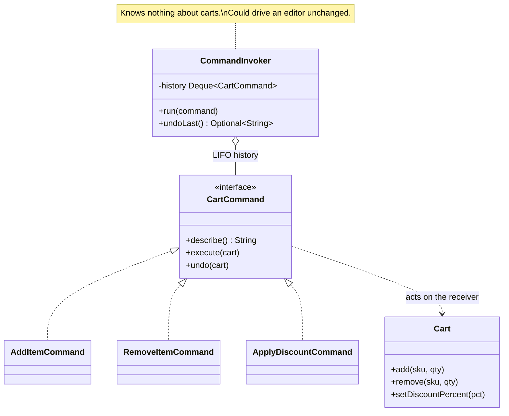

# Command

**Category:** Behavioral
**Package:** `com.example.designpatterns.behavioral.command`

## Intent

Encapsulate a request as an object, thereby letting you parameterize clients with
different requests, queue or log requests, and support undoable operations.

## The problem it solves

`cart.add("WIDGET-1", 3)` does the job — but the *call* leaves no trace. You cannot
store it, replay it, put it on a queue, or take it back.

Turning the call into an object gives you all of those:

```java
public interface CartCommand {
    String describe();
    void execute(Cart cart);
    void undo(Cart cart);
}
```

The invoker keeps a stack and pops it to undo. `CommandTest.undoingEveryCommandRestoresTheExactStartingState`
asserts the round trip: run three commands, undo three commands, and the cart's
snapshot equals the original string exactly.

## The part tutorials get wrong

**A command must capture what its `undo` will need.** Two different techniques appear
in this package:

```java
// RemoveItemCommand: record what ACTUALLY happened, not what was asked
public void execute(Cart cart) {
    int before = cart.items().getOrDefault(sku, 0);
    cart.remove(sku, quantity);
    actuallyRemoved = before - cart.items().getOrDefault(sku, 0);
}
```

Ask to remove 5 when only 2 are present, and a naive undo re-adds 5 — inventing
stock that never existed. `CommandTest.removingMoreThanIsPresentDoesNotInventStockOnUndo`
pins it.

```java
// ApplyDiscountCommand: snapshot the value you are about to overwrite
public void execute(Cart cart) {
    previous = cart.discountPercent();
    cart.setDiscountPercent(percent);
}
```

This second technique is Memento in miniature.

## Structure



## Participants

| Role | Type | Location |
|---|---|---|
| Command | `CartCommand` | `src/main/java/com/example/designpatterns/behavioral/command/CartCommand.java` |
| Concrete Commands | `AddItemCommand`, `RemoveItemCommand`, `ApplyDiscountCommand` | `src/main/java/com/example/designpatterns/behavioral/command/` |
| Receiver | `Cart` | `src/main/java/com/example/designpatterns/behavioral/command/Cart.java` |
| Invoker | `CommandInvoker` | `src/main/java/com/example/designpatterns/behavioral/command/CommandInvoker.java` |

`CommandTest.theInvokerNeverNamesTheReceiversOperations` asserts the invoker exposes
no `add`/`remove` — it is genuinely reusable.

## Trade-offs — and when NOT to use it

- **One class per operation.** Ten operations, ten classes.
- **Undo correctness is entirely manual.** Nothing checks that `undo` actually
  reverses `execute`. The only defence is the round-trip test in `CommandTest`, and
  every new command needs its own.
- **Not everything is undoable.** Sending an email, charging a card, deleting a file.
  A "compensating" undo is a different operation, not a reversal, and pretending
  otherwise is dangerous.
- **Memory.** An unbounded history holds every command and its captured state.

**Don't use it** when you need neither undo, queueing, nor logging — then it is a
method call wrapped in ceremony. In modern Java a simple `Runnable` or `Consumer<T>`
lambda covers the "parameterize with a request" half without the class.

## Where Spring uses this internally

`@Async` methods and `TaskExecutor.execute(Runnable)` are Command: the request is
packaged as an object and handed to something that decides when to run it. Spring
Batch models steps as executable, restartable objects. `ApplicationRunner` and
`CommandLineRunner` are startup commands. Spring's `@Retryable` re-invokes a
packaged operation — only possible because the operation is an object.

## Try it

```bash
curl -s localhost:8080/api/patterns/command | jq
```

Check `returnedToStart`: four commands, four undos, byte-identical cart.
