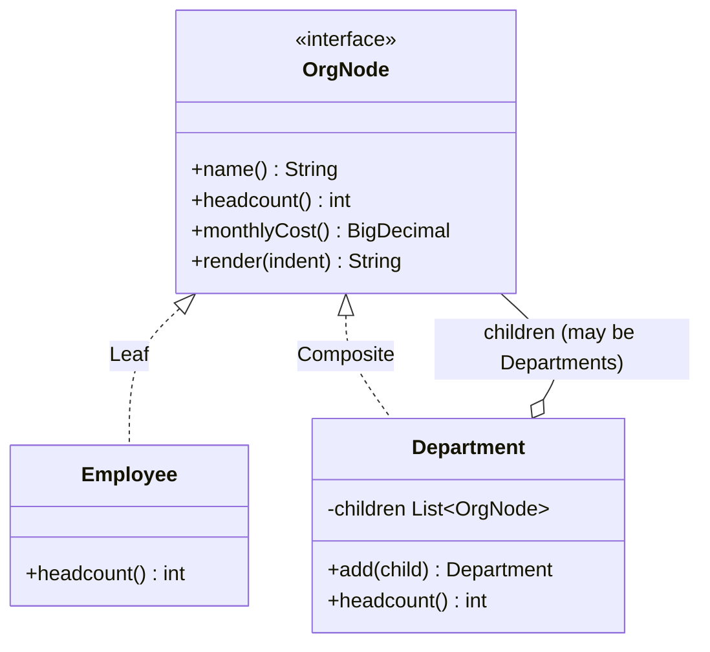

# Composite

**Category:** Structural
**Package:** `com.example.designpatterns.structural.composite`

## Intent

Compose objects into tree structures to represent part-whole hierarchies. Composite
lets clients treat individual objects and compositions of objects uniformly.

## The problem it solves

An org chart is a tree: departments contain employees *and other departments*, to
any depth. Without Composite, every client that walks it must branch:

```java
int headcount(Object node) {
    if (node instanceof Employee) return 1;
    if (node instanceof Department d) {                 // and recurse by hand
        int total = 0;
        for (Object child : d.children()) total += headcount(child);
        return total;
    }
    throw new IllegalArgumentException("what even is this");
}
```

That `instanceof` ladder is copied into every operation — headcount, cost,
rendering, export — and each copy must handle the recursion correctly.

Composite pushes the branch into the type system. `Employee.headcount()` returns 1;
`Department.headcount()` sums its children. The client just calls `headcount()`.

The insight worth keeping: **a leaf is not a special case, it is a subtree of size
one.**

## Structure



## Participants

| Role | Type | Location |
|---|---|---|
| Component | `OrgNode` | `src/main/java/com/example/designpatterns/structural/composite/OrgNode.java` |
| Leaf | `Employee` (record) | `src/main/java/com/example/designpatterns/structural/composite/Employee.java` |
| Composite | `Department` | `src/main/java/com/example/designpatterns/structural/composite/Department.java` |

## Trade-offs — and when NOT to use it

- **The uniform interface is a compromise.** GoF's original puts `add`/`remove` on
  the *component*, so clients are fully uniform — but then `Employee.add()` exists
  and must fail at runtime. This package takes the other option: `add` lives only on
  `Department`, which is type-safe but means building a tree requires knowing which
  nodes are composites. There is no third option; pick your poison knowingly.
- **Recursion has no depth limit.** A deep or cyclic structure will overflow the
  stack. Nothing here prevents adding a department to itself.
- **Repeated traversal is O(n) every time.** `headcount()` recomputes the whole
  subtree on each call. Caching it means invalidation on every mutation.

**Don't use it** when the structure is not genuinely recursive. A two-level
grouping is a `Map<String, List<T>>`, not a tree.

## Where Spring uses this internally

`CompositeCacheManager`, `CompositeHealthContributor` and
`DelegatingFilterProxy`-style chains apply the pattern by name: a group of N things
implementing the same interface as one thing. Spring Security's `HttpSecurity` builds
a composite filter chain. Outside Spring, `java.io.File` and every DOM/UI tree are
composites.

## Try it

```bash
curl -s localhost:8080/api/patterns/composite | jq -r '.tree[]'
curl -s localhost:8080/api/patterns/composite | jq '{wholeCompanyHeadcount, singleEmployeeHeadcount}'
```

The same four methods answered for a five-person company and for one employee.
