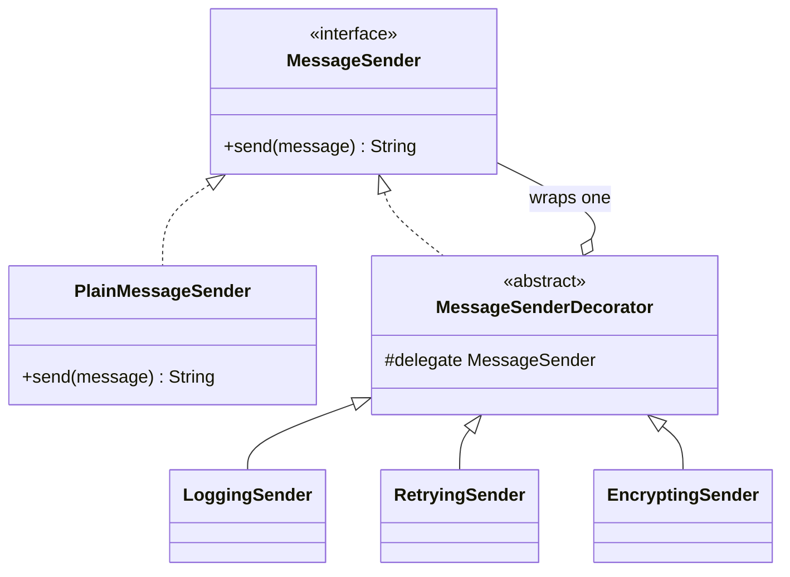

# Decorator

**Category:** Structural
**Package:** `com.example.designpatterns.structural.decorator`

## Intent

Attach additional responsibilities to an object dynamically. Decorators provide a
flexible alternative to subclassing for extending functionality.

## The problem it solves

You need message sending with logging. And with retries. And with encryption. And
sometimes two of the three, in a particular order.

By inheritance that is a class per combination: `LoggingSender`, `RetryingSender`,
`LoggingRetryingSender`, `EncryptingLoggingRetryingSender`… Three independent
concerns give you 2³ classes, and the eighth one is written by hand.

By decoration it is three classes, composed at the call site:

```java
new LoggingSender(new EncryptingSender(new RetryingSender(sender, 3)), log);
```

**Order is part of the design, not an accident.** These two are both valid and
mean different things:

```java
new LoggingSender(new EncryptingSender(plain), log);   // logs PLAINTEXT
new EncryptingSender(new LoggingSender(plain, log));   // logs CIPHERTEXT
```

One of those is a security incident. `DecoratorTest.wrappingOrderChangesWhatEachLayerSees`
pins the difference so a future refactor cannot quietly swap them.

## Structure



The decorator both **implements** the component interface and **holds** one. That
double relationship is what makes chains of arbitrary depth type-check.

## Participants

| Role | Type | Location |
|---|---|---|
| Component | `MessageSender` | `src/main/java/com/example/designpatterns/structural/decorator/MessageSender.java` |
| Concrete Component | `PlainMessageSender` | `src/main/java/com/example/designpatterns/structural/decorator/PlainMessageSender.java` |
| Decorator | `MessageSenderDecorator` | `src/main/java/com/example/designpatterns/structural/decorator/MessageSenderDecorator.java` |
| Concrete Decorators | `LoggingSender`, `RetryingSender`, `EncryptingSender` | `src/main/java/com/example/designpatterns/structural/decorator/` |

## Trade-offs — and when NOT to use it

- **Debugging gets harder.** A stack trace through five decorators is five frames of
  `send` before anything interesting. Identity comparisons fail: the decorated object
  is not `==` the one you wrapped.
- **Order is invisible at the point of failure.** The composition happens somewhere
  else entirely; a bug caused by wrong ordering does not look like an ordering bug.
- **Interface changes ripple.** Add a method to `MessageSender` and every decorator
  needs it.
- **Wrapping is not free.** One object and one virtual call per layer.

**Don't use it** when the concerns are not independent, or when the combinations you
actually need number two. And `EncryptingSender` here uses ROT13 — that is a
readable placeholder, never encryption.

## Decorator vs. Proxy

Both wrap an object of the same interface. The difference is intent: a **decorator**
adds behaviour the caller wants and knows about; a **proxy** controls access to the
subject while pretending to be it. Same shape, opposite advertising.

## Where Spring uses this internally

`BeanPostProcessor` decorates beans as they are created — this is how AOP proxies
get installed. `HttpServletRequestWrapper` and `HttpServletResponseWrapper` are
decorators from the Servlet API that Spring uses heavily (Spring Security wraps the
request to add the principal). `TransactionAwareCacheDecorator` is one by name.

## Try it

```bash
curl -s localhost:8080/api/patterns/decorator | jq
```

Compare the two `log` arrays: identical layers, opposite order, different security
properties.
