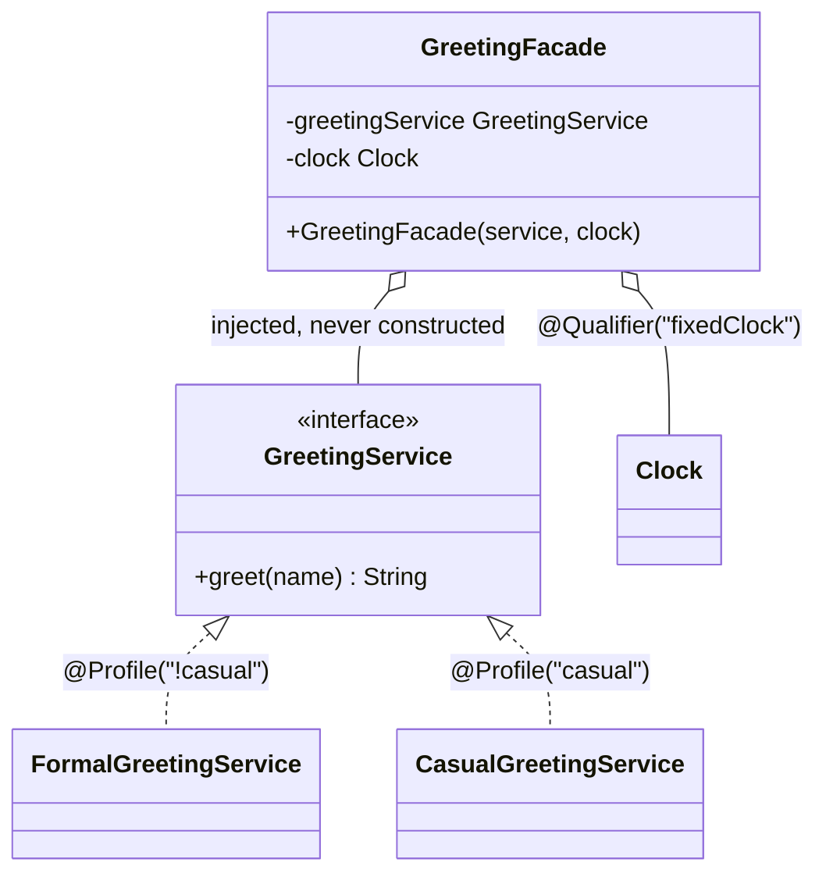

# Dependency Injection / Inversion of Control

**Category:** Spring idiom
**Package:** `com.example.designpatterns.spring.dependencyinjection`

## Intent

Invert control of dependency creation: an object declares what it needs and something
else supplies it, rather than constructing or locating it itself.

This is not a Gang of Four pattern, but it is the pattern Spring *is*, and most of the
other patterns in this catalogue are easier to apply because of it.

## The problem it solves

A class that builds its own collaborators is welded to them:

```java
public class GreetingFacade {
    private final GreetingService service = new FormalGreetingService();  // welded
    private final Clock clock = Clock.systemUTC();                       // untestable
}
```

You cannot substitute the greeting for a test, cannot vary it per environment, and
cannot freeze the clock — so any test of time-dependent behaviour is flaky by
construction.

Declaring the dependencies instead:

```java
public GreetingFacade(GreetingService greetingService, @Qualifier("fixedClock") Clock clock) {
    this.greetingService = greetingService;
    this.clock = clock;
}
```

Now `DependencyInjectionTest.constructorInjectionMakesTheClassTestableWithoutAContainer`
builds one with a lambda and a fixed clock — no Spring, no mocking framework, and a
deterministic assertion on the exact output string.

## Why constructor injection, and not the others

| | Constructor | Setter | Field (`@Autowired` on a field) |
|---|---|---|---|
| Fields can be `final` | yes | no | no |
| Object always fully initialised | yes | no | no |
| Dependencies visible in the API | yes | partly | **no** |
| Testable without reflection | yes | yes | **no** |
| Hides that a class has 15 dependencies | no | somewhat | **yes** |

The last row is the one people underrate. With constructor injection, a class that
has grown fifteen dependencies has a fifteen-parameter constructor, and that
discomfort is *useful feedback* that the class does too much. Field injection makes
that class look exactly as innocent as one with two.

`DependencyInjectionTest.everyDependencyIsVisibleInTheConstructorSignature` asserts
one constructor and all-`final` fields.

Since Spring 4.3 a single constructor needs no `@Autowired` at all.

## Structure



## Participants

| Role | Type | Location |
|---|---|---|
| Abstraction | `GreetingService` | `src/main/java/com/example/designpatterns/spring/dependencyinjection/GreetingService.java` |
| Implementations | `FormalGreetingService`, `CasualGreetingService` | `src/main/java/com/example/designpatterns/spring/dependencyinjection/` |
| Consumer | `GreetingFacade` | `src/main/java/com/example/designpatterns/spring/dependencyinjection/GreetingFacade.java` |
| Ambiguous beans | `ClockConfiguration` | `src/main/java/com/example/designpatterns/spring/dependencyinjection/ClockConfiguration.java` |

## `@Qualifier`: why two beans of one type is a startup failure

`ClockConfiguration` declares two `Clock` beans deliberately. An unqualified `Clock`
injection point is then ambiguous and **the context refuses to start**.

That refusal is correct behaviour. Guessing would be silent, and the wrong clock
produces wrong timestamps that nobody notices for months. `@Qualifier("fixedClock")`
names the intended bean; the `@Bean` method name is the bean name.

## `@Profile`: swapping an implementation without touching code

`FormalGreetingService` is `@Profile("!casual")`, `CasualGreetingService` is
`@Profile("casual")`. `CasualProfileTest` activates the profile and asserts the wired
implementation changed — with **no edit to `GreetingFacade` or to either service**.

## Trade-offs — and when NOT to use it

- **Wiring errors move to runtime.** A missing or ambiguous bean is a startup
  failure, not a compile error. Startup is early, but it is not compile time.
- **The object graph becomes implicit.** "Where does this instance come from?" needs
  the container to answer, not the code.
- **Container magic is real magic.** Profiles, conditionals and auto-configuration
  can make the active wiring genuinely hard to determine. `/actuator/beans` and
  `--debug` exist for this reason.

**Don't use a container** for a small program or a library — plain constructor
injection (just passing arguments) gives you every testability benefit with none of
the magic. DI the *principle* is always worth it; DI the *framework* is not.

## Where Spring uses this internally

The whole container: `BeanFactory` is a Factory, bean scopes give you Singleton and
Prototype, `@Bean` methods are Factory Methods, and AOP is Proxy. `@Qualifier`,
`@Primary`, `@Profile` and `@Conditional` are the selection mechanisms.

## Try it

```bash
curl -s localhost:8080/api/patterns/dependencyinjection | jq

# and with the profile flipped
SPRING_PROFILES_ACTIVE=casual ./gradlew bootRun
curl -s localhost:8080/api/patterns/dependencyinjection | jq '.wiredImplementation'
```
