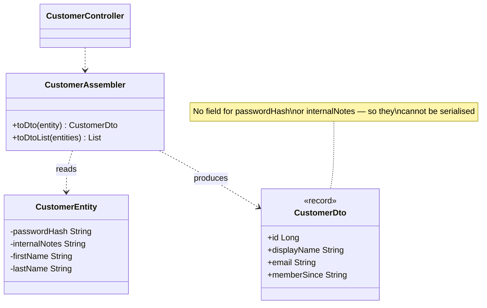

# DTO / Assembler

**Category:** Spring idiom
**Package:** `com.example.designpatterns.spring.dto`

## Intent

Carry data across a process or API boundary in a shape owned by that boundary,
decoupling the wire contract from the internal model.

## The problem it solves

Return an entity from a controller and Jackson serialises **every field it can
reach**:

```java
@GetMapping("/customers")
public List<CustomerEntity> customers() {  // DANGER
    return repository.findAll();
}
```

`CustomerEntity` holds `passwordHash` and `internalNotes` ("VIP — route to senior
support"). Both are now in the JSON. Nothing warned you. No test failed. The leak is
discovered by a customer reading their own API response.

And even without sensitive fields, the coupling bites: rename an entity field and
every client breaks; add a lazy association and serialisation triggers a query — or
throws `LazyInitializationException` after the transaction closed.

The DTO declares exactly what the boundary exposes:

```java
public record CustomerDto(Long id, String displayName, String email, String memberSince) {}
```

There is no field for the password hash, so **it cannot leak** — omission is enforced
by the type, not by remembering an annotation.

## The test that actually proves it

```java
@Test
void theSerialisedDtoExposesExactlyTheAgreedKeys() throws Exception {
    String json = objectMapper.writeValueAsString(assembler.toDto(entity()));
    var keys = objectMapper.readValue(json, Map.class).keySet();
    assertThat(keys).containsExactlyInAnyOrder("id", "displayName", "email", "memberSince");
}
```

Note it asserts on the **serialised JSON keys**, not on the record's declaration.
Asserting the record shape would pass trivially and prove nothing; asserting the JSON
proves what a caller actually receives. `theEntityStillHoldsTheFieldsTheDtoOmits`
confirms the omission is the DTO's doing and not missing data.

## Structure



## Participants

| Role | Type | Location |
|---|---|---|
| Internal model | `CustomerEntity` | `src/main/java/com/example/designpatterns/spring/dto/CustomerEntity.java` |
| DTO | `CustomerDto` (record) | `src/main/java/com/example/designpatterns/spring/dto/CustomerDto.java` |
| Assembler | `CustomerAssembler` | `src/main/java/com/example/designpatterns/spring/dto/CustomerAssembler.java` |
| Client | `CustomerController` | `src/main/java/com/example/designpatterns/spring/dto/CustomerController.java` |

## Why a separate assembler

Concentrating the mapping in one class means there is exactly **one place to audit**
when asking "can this field reach a client?". Scatter `new CustomerDto(...)` across
five controllers and that question becomes unanswerable.

The assembler also *reshapes* rather than merely copying: `firstName + lastName`
becomes `displayName`, and a `LocalDate` becomes `"March 2019"`. The API gets what a
UI wants, not what a database row holds.

## Trade-offs — and when NOT to use it

- **Duplication, and it is real.** Every field appears in the entity, in the DTO, and
  in the assembler. Adding one means editing three files. This is the standard
  objection and it is correct — the answer is that the duplication is the *point*: it
  is what lets the two shapes evolve separately.
- **Mapping libraries have their own cost.** MapStruct generates the assembler at
  compile time (good); reflection-based mappers move mapping errors to runtime and
  can silently skip a renamed field (bad).
- **DTO sprawl.** Read DTOs, write DTOs, summary DTOs, per-version DTOs. Real, and
  usually still better than the alternative.

**Don't use it** when the internal model *is* the contract and always will be — a
tiny internal service, a throwaway tool. And do not solve the leak with
`@JsonIgnore` on entity fields: that is opt-out security, and the next developer to
add a sensitive field will not know they had to opt out.

## Where this shows up in this project

The lesson has to hold everywhere or it is not a lesson: `BookController` in the
repository package returns `BookView`, not the `Book` entity, for exactly these
reasons.

## Where Spring uses this internally

`@RequestBody` and `@ResponseBody` with `HttpMessageConverter` are the DTO boundary.
Spring Data projections (interface- or class-based) generate DTOs straight from
queries, avoiding loading the entity at all. `ProblemDetail` — used by this project's
`CatalogExceptionHandler` — is a DTO for errors.

## Try it

```bash
curl -s localhost:8080/api/patterns/dto | jq
curl -s localhost:8080/api/patterns/dto/customers | jq
```

`whatTheEntityHolds` lists seven fields; `whatTheApiExposes` has four.
