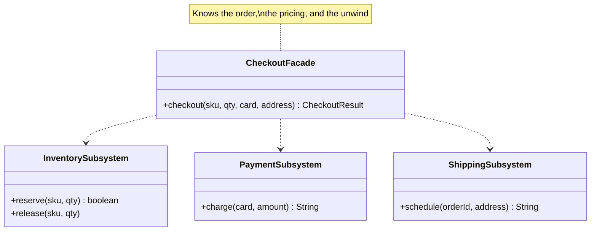

# Facade

**Category:** Structural
**Package:** `com.example.designpatterns.structural.facade`

## Intent

Provide a unified interface to a set of interfaces in a subsystem. Facade defines a
higher-level interface that makes the subsystem easier to use.

## The problem it solves

Checking out requires three subsystems in the right order, and — the part that
actually bites — a correct **unwind** when a later step fails:

```java
// every caller would have to get this right, every time
if (!inventory.reserve(sku, qty)) return "out of stock";
try {
    payment.charge(card, price);
} catch (IllegalStateException declined) {
    inventory.release(sku, qty);          // forget this line and stock leaks
    return "declined";
}
shipping.schedule(orderId, address);
```

Copy that into three callers and one of them will forget the `release`. The stock
count drifts, nobody knows why, and the bug is invisible until inventory is wrong.

`CheckoutFacade` holds that knowledge once. `FacadeTest` asserts the failure path
explicitly: on a declined payment, `stepsTaken` is
`[inventory.reserve, payment.charge, inventory.release]` and contains nothing
starting with `shipping`.

## Structure



## Participants

| Role | Type | Location |
|---|---|---|
| Facade | `CheckoutFacade` | `src/main/java/com/example/designpatterns/structural/facade/CheckoutFacade.java` |
| Subsystems | `InventorySubsystem`, `PaymentSubsystem`, `ShippingSubsystem` | `src/main/java/com/example/designpatterns/structural/facade/` |
| Result | `CheckoutResult` (record) | `src/main/java/com/example/designpatterns/structural/facade/CheckoutResult.java` |

## Trade-offs — and when NOT to use it

- **Facades attract scope.** Today it orchestrates three subsystems; in a year it has
  forty methods and is the god object everything depends on. Watch its size.
- **It can hide too much.** A caller needing a partial flow either gets a new facade
  method or goes around the facade. Both erode it.
- **A facade is not a boundary.** It does not *prevent* direct subsystem access, and
  it should not try. Keep the subsystems independently usable, or the facade becomes
  a bottleneck rather than a convenience.

**Don't use it** when there is one subsystem and one call — that is a wrapper adding
nothing. And do not confuse it with **Mediator**: a facade is a one-way simplification
over a subsystem that does not know it exists; a mediator sits *between* peers that
all talk through it.

## Where Spring uses this internally

Your own `@Service` layer is the facade Spring most encourages: one transactional
method orchestrating several repositories, so controllers never see persistence.
`JdbcTemplate` is a facade over the raw JDBC subsystem (`Connection`, `Statement`,
`ResultSet`, and their exception handling). `RestClient`/`WebClient` are facades over
HTTP machinery.

## Try it

```bash
curl -s localhost:8080/api/patterns/facade | jq '.happyPath.stepsTaken, .paymentDeclined.stepsTaken, .outOfStock.stepsTaken'

curl -s -X POST 'localhost:8080/api/patterns/facade/checkout?sku=WIDGET-1&quantity=2&card=FAIL-CARD&address=London' | jq
```

Compare the three `stepsTaken` arrays — that is the orchestration knowledge, made
visible.
