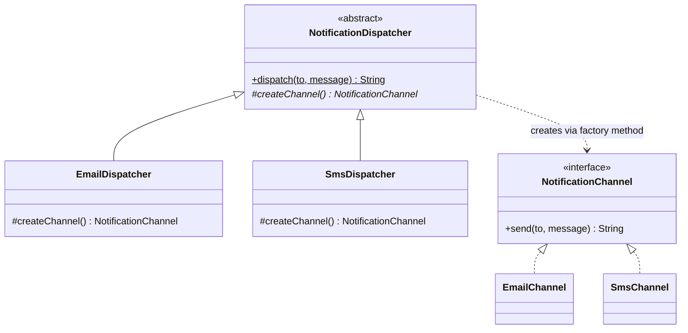

# Factory Method

**Category:** Creational
**Package:** `com.example.designpatterns.creational.factorymethod`

## Intent

Define an interface for creating an object, but let subclasses decide which class
to instantiate. Factory Method lets a class defer instantiation to subclasses.

## The problem it solves

You have an algorithm that is identical for every case except for *which object it
works on*. Written directly, it grows a conditional:

```java
public String dispatch(String to, String message, String channelType) {
    if (to == null || to.isBlank()) throw new IllegalArgumentException(...);
    NotificationChannel channel;
    if (channelType.equals("email")) channel = new EmailChannel();
    else if (channelType.equals("sms")) channel = new SmsChannel();
    else throw new IllegalArgumentException(...);      // grows every quarter
    return channel.send(to, message);
}
```

Every new channel edits this method, and the validation gets re-tested each time.

Factory Method splits the two concerns: `NotificationDispatcher.dispatch` holds the
invariant algorithm and is `final`; `createChannel()` is abstract and is the only
thing a subclass supplies.

## Structure



## Participants

| Role | Type | Location |
|---|---|---|
| Creator | `NotificationDispatcher` | `src/main/java/com/example/designpatterns/creational/factorymethod/NotificationDispatcher.java` |
| Concrete Creator | `EmailDispatcher`, `SmsDispatcher` | `src/main/java/com/example/designpatterns/creational/factorymethod/` |
| Product | `NotificationChannel` | `src/main/java/com/example/designpatterns/creational/factorymethod/NotificationChannel.java` |
| Concrete Product | `EmailChannel`, `SmsChannel` | `src/main/java/com/example/designpatterns/creational/factorymethod/` |

## Trade-offs — and when NOT to use it

- **One subclass per product.** Two channels means two dispatchers. The class count
  doubles, which is real cost for a small number of products.
- **It requires inheritance.** The creator and its variants are locked into a
  hierarchy. If you also need to vary something else, you get a combinatorial mess —
  that is when Strategy (composition) is the better tool.
- **`dispatch` is `final` on purpose.** Subclasses vary the *product*, never the
  *algorithm*. Remove that `final` and the pattern's guarantee evaporates.

**Don't use it** when the choice of product is data, not type: a `Map<String, Supplier<T>>`
or Strategy is simpler than a subclass per branch. And don't use it when there is
only one product and no prospect of another — that is a constructor call with extra
steps.

## Where Spring uses this internally

Every `@Bean` method is a factory method: you write the creation logic, and the
container decides when to call it and what to do with the result. `FactoryBean<T>`
is the more explicit form — a bean whose job is producing another bean.
`ObjectProvider<T>` and `ObjectFactory<T>` are the deferred-lookup variants.

## Try it

```bash
curl -s localhost:8080/api/patterns/factorymethod | jq
```

Both output lines come from the same inherited `dispatch()`; only the product
differs.
