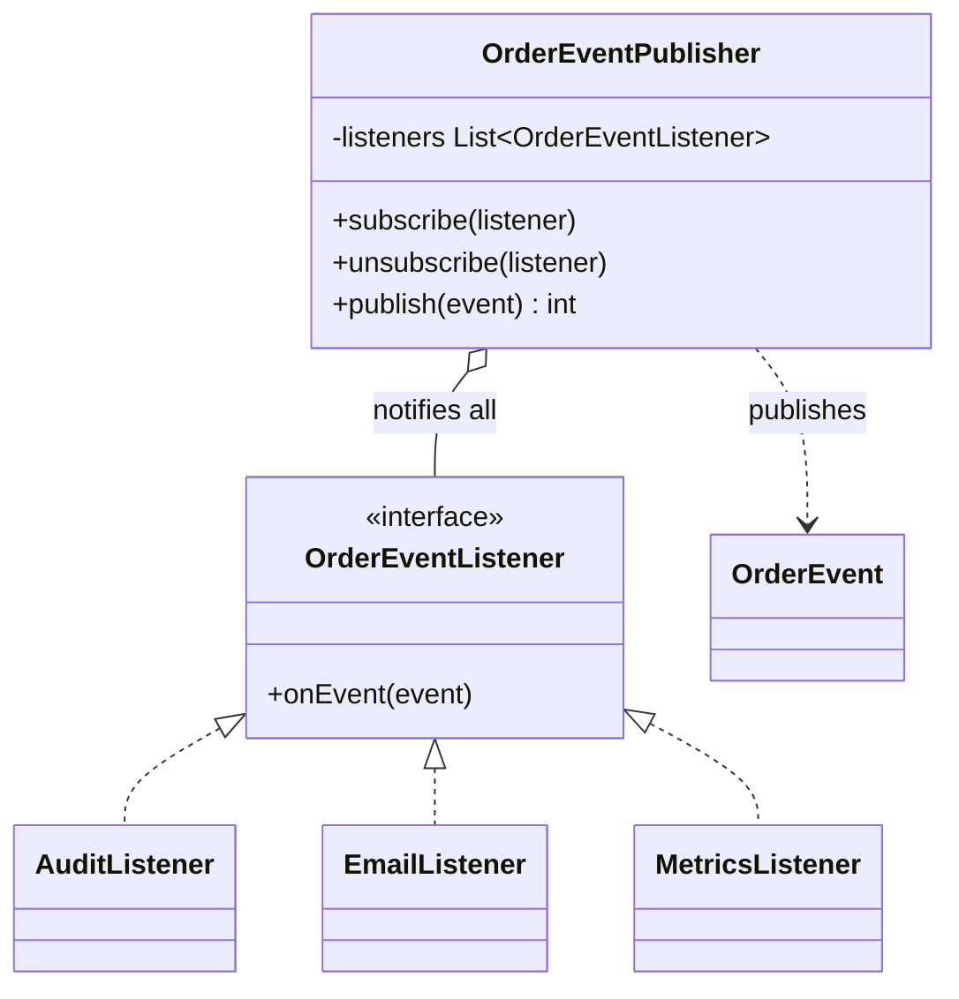

# Observer

**Category:** Behavioral
**Package:** `com.example.designpatterns.behavioral.observer`

## Intent

Define a one-to-many dependency between objects so that when one object changes
state, all its dependents are notified and updated automatically.

## The problem it solves

Placing an order must write an audit row, email the customer, and bump a metric.
Written directly, the order service calls all three — and therefore *depends* on all
three. Adding a fourth consumer means editing the order service, which then needs
re-testing, and its unit test now needs three mocks that have nothing to do with
placing orders.

Observer inverts it: the publisher announces *that something happened* and knows
nothing about who cares. `ObserverTest.theSubjectNeverNamesAConcreteObserver`
asserts no concrete listener type appears in `OrderEventPublisher`'s signatures.

## Two decisions naive implementations get wrong

**A failing observer must not silence the others.**

```java
for (OrderEventListener listener : listeners) {
    notified++;
    try {
        listener.onEvent(event);
    } catch (RuntimeException e) {
        failures.add(listener.getClass().getSimpleName() + ": " + e.getMessage());
    }
}
```

Without that `try`, one broken listener swallows the notification for every listener
registered *after* it — and which ones those are depends on registration order, so
the bug is intermittent. Note the failures are *recorded*, not discarded: silently
swallowing them would be its own bug.

**The listener list must tolerate mutation during iteration.** A listener that
unsubscribes itself while handling an event would otherwise throw
`ConcurrentModificationException`. Hence `CopyOnWriteArrayList`.

## Structure



## Participants

| Role | Type | Location |
|---|---|---|
| Subject | `OrderEventPublisher` | `src/main/java/com/example/designpatterns/behavioral/observer/OrderEventPublisher.java` |
| Observer | `OrderEventListener` | `src/main/java/com/example/designpatterns/behavioral/observer/OrderEventListener.java` |
| Concrete Observers | `AuditListener`, `EmailListener`, `MetricsListener` | `src/main/java/com/example/designpatterns/behavioral/observer/` |
| Event | `OrderEvent` (record, immutable) | `src/main/java/com/example/designpatterns/behavioral/observer/OrderEvent.java` |
| Spring-native form | `SpringOrderEvents`, `SpringEventRecorder` | `src/main/java/com/example/designpatterns/behavioral/observer/` |

The event is a **record** deliberately: the same instance reaches every listener, so
a mutable event would let one listener change what the others see.

## Trade-offs — and when NOT to use it

- **Control flow becomes invisible.** "What happens when an order is placed?" is no
  longer answerable by reading the order service. You must search for listeners. This
  is the single biggest cost, and it is paid by every future reader.
- **Memory leaks.** A listener that never unsubscribes keeps its whole object graph
  alive. Classic in long-lived publishers.
- **Ordering is unspecified.** If listener B depends on listener A having run, you
  have a hidden coupling that will break silently.
- **Synchronous by default.** A slow listener slows the publisher. Making it async
  then raises the question of what happens to failures.

**Don't use it** when there is exactly one consumer and always will be — that is a
method call with extra indirection. And do not use it to paper over a design where
two components genuinely need to know about each other.

## Where Spring uses this internally

`ApplicationEventPublisher` is the subject; any bean method annotated `@EventListener`
is an observer, registered automatically — no `subscribe` call, no leak risk.

`@TransactionalEventListener` is the version worth remembering: it defers the
notification until after the surrounding transaction commits, so you never email a
customer about an order that then rolled back.

Spring's own lifecycle is built on this: `ContextRefreshedEvent`,
`ApplicationReadyEvent`, and Spring Security's `AuthenticationSuccessEvent`.

## Try it

```bash
curl -s localhost:8080/api/patterns/observer | jq
```

Note `swallowedListenerFailures`: one listener threw, and the rest still ran.
