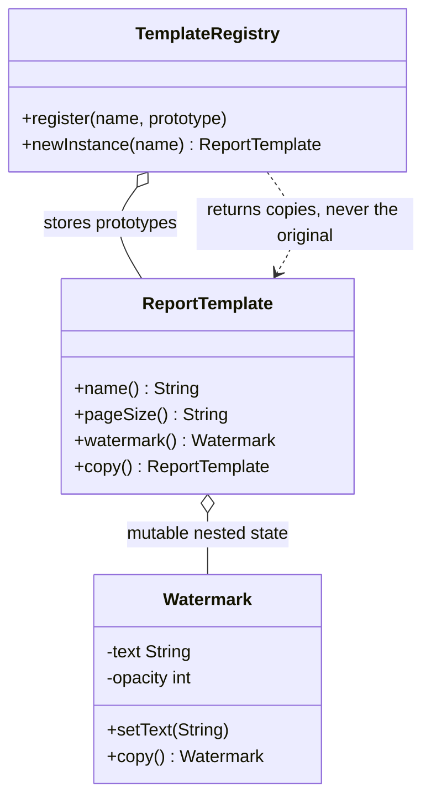

# Prototype

**Category:** Creational
**Package:** `com.example.designpatterns.creational.prototype`

## Intent

Specify the kinds of objects to create using a prototypical instance, and create new
objects by copying this prototype.

## The problem it solves

Sometimes *configuring* an object is expensive or fiddly, while *copying* it is
cheap. A report template with page size, margins, fonts and a watermark takes
twenty lines to build correctly and one line to copy. Registering the configured
instance once and cloning it per report avoids repeating (and mis-repeating) that
setup.

**The whole lesson of this package is depth of copy.** If `copy()` shares the
nested `Watermark` between the prototype and its copies, then mutating one copy
silently corrupts the prototype and every copy made afterwards. The bug appears far
from its cause and is miserable to find.

`PrototypeTest.mutatingACopysNestedStateLeavesThePrototypeUntouched` is the
regression test for exactly that. A shallow copy fails it:

```java
// WRONG — shallow: prototype and copy share one Watermark
public ReportTemplate copy() {
    return new ReportTemplate(name, pageSize, watermark);
}

// RIGHT — deep: the nested mutable object is copied too
public ReportTemplate copy() {
    return new ReportTemplate(name, pageSize, watermark.copy());
}
```

## Structure



## Participants

| Role | Type | Location |
|---|---|---|
| Prototype | `ReportTemplate` | `src/main/java/com/example/designpatterns/creational/prototype/ReportTemplate.java` |
| Mutable nested state | `Watermark` | `src/main/java/com/example/designpatterns/creational/prototype/Watermark.java` |
| Prototype Registry | `TemplateRegistry` | `src/main/java/com/example/designpatterns/creational/prototype/TemplateRegistry.java` |

## Trade-offs — and when NOT to use it

- **Deep copying is easy to get wrong and hard to keep right.** Add a mutable field
  later and forget to copy it, and you have reintroduced the bug. There is no
  compiler help.
- **Cycles and shared references.** A graph with cycles needs identity tracking; a
  deliberately shared reference must *not* be copied. `copy()` has to make that call.
- **`Cloneable` is a trap.** `Object.clone()` bypasses constructors, is shallow by
  default, and its contract is unenforced. This package uses a plain `copy()` method
  instead, and you should too.

**Don't use it** when the object is immutable — copying an immutable object is
pointless, just share it. And don't use it when construction is cheap; a factory or
a builder is clearer.

## Where Spring uses this internally

`@Scope("prototype")` is the same idea at container level: every injection point or
`getBean` call receives a **new** instance rather than the shared singleton. Note
Spring does not copy anything — it re-runs the factory. Note also that Spring does
not manage a prototype bean's destruction lifecycle; that is yours.

## Try it

```bash
curl -s localhost:8080/api/patterns/prototype | jq
```

The copy's watermark reads `FINAL`; the registered prototype still reads `DRAFT`.
