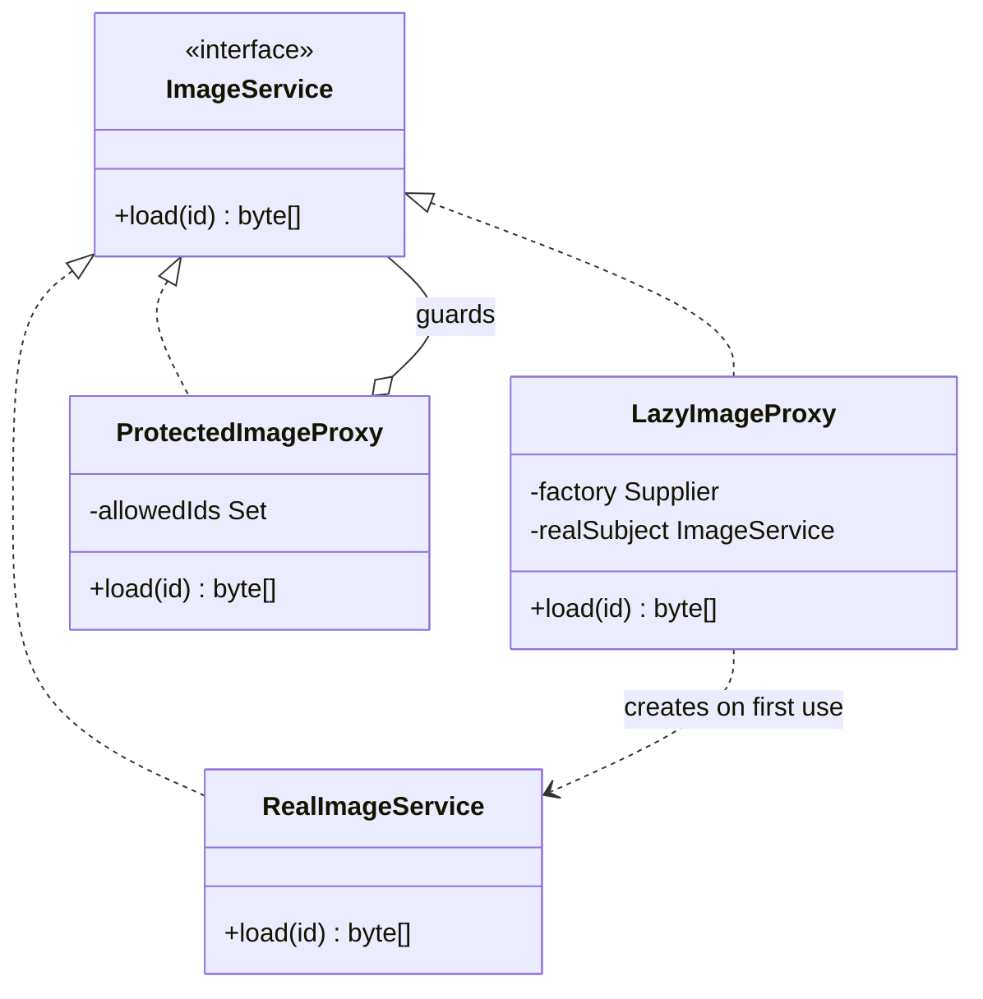

# Proxy

**Category:** Structural
**Package:** `com.example.designpatterns.structural.proxy`

## Intent

Provide a surrogate or placeholder for another object to control access to it.

## The problem it solves

Two independent needs, one shape:

**Virtual proxy — defer expense.** `RealImageService` is (notionally) costly to
construct. Most requests never touch it. `LazyImageProxy` holds a `Supplier` and
builds the real thing on first use:

```java
private volatile ImageService realSubject;   // double-checked locking
```

The caller holds an `ImageService` either way and cannot tell the difference, which
is what makes the optimisation safe to apply *after* the code was written.

**Protection proxy — enforce a rule.** `ProtectedImageProxy` checks the id against
an allow-list **before** delegating, so a forbidden call never reaches the real
service at all. `ProxyTest` asserts the delegate's call count stays at zero for a
denied request — "it threw" is not enough; the point is that the work never happened.

## Structure



## Participants

| Role | Type | Location |
|---|---|---|
| Subject | `ImageService` | `src/main/java/com/example/designpatterns/structural/proxy/ImageService.java` |
| Real Subject | `RealImageService` | `src/main/java/com/example/designpatterns/structural/proxy/RealImageService.java` |
| Virtual Proxy | `LazyImageProxy` | `src/main/java/com/example/designpatterns/structural/proxy/LazyImageProxy.java` |
| Protection Proxy | `ProtectedImageProxy` | `src/main/java/com/example/designpatterns/structural/proxy/ProtectedImageProxy.java` |
| Spring's own proxying | `AuditedService`, `AuditAspect` | `src/main/java/com/example/designpatterns/structural/proxy/` |

## Trade-offs — and when NOT to use it

- **The object you hold is not the object you wrote.** This is the source of a
  whole family of confusing bugs — see self-invocation below.
- **Lazy initialisation moves failures.** A construction error now surfaces at first
  *use*, potentially deep inside unrelated code.
- **Thread safety is on you.** `LazyImageProxy` needs `volatile` plus double-checked
  locking; get it wrong and two threads build two "singletons".

**Don't use it** to add behaviour the caller *wants* to know about — that is
Decorator. And do not hand-roll a caching proxy when `@Cacheable` exists.

## Where Spring uses this internally — and the bug it causes

This is the most important Spring mechanism in the whole catalogue.

When a bean matches a pointcut, Spring registers a **generated proxy** in its place.
`@Transactional`, `@Cacheable`, `@Async`, `@Retryable`, `@PreAuthorize` and
`@Validated` all work this way. `AuditAspectTest` asserts
`AopUtils.isAopProxy(service)` is `true` and that `service.getClass() != AuditedService.class`.

Which explains the classic trap:

```java
public String performTwiceInternally(String action) {
    return perform(action) + " / " + perform(action);   // this.perform — NOT the proxy
}
```

The inner calls go straight to `this`, bypassing the proxy entirely, so **no advice
runs for them**. `AuditAspectTest.selfInvocationBypassesTheProxy` asserts exactly one
audit entry for two internal calls. The same mechanism silently drops
`@Transactional` on internal calls — a bug that produces no error, just missing
transactions.

Fixes: move the inner method to another bean, inject self, or use AspectJ weaving.

Two proxy flavours: **JDK dynamic proxies** (interface-based) and **CGLIB** (subclass-based,
Spring Boot's default). CGLIB cannot proxy `final` classes or `final` methods — which
is why a `final` service class quietly loses its `@Transactional`.

## Try it

```bash
curl -s localhost:8080/api/patterns/proxy | jq
```

Look at `springProxyClass` — the `$$SpringCGLIB$$` suffix is the generated subclass.
