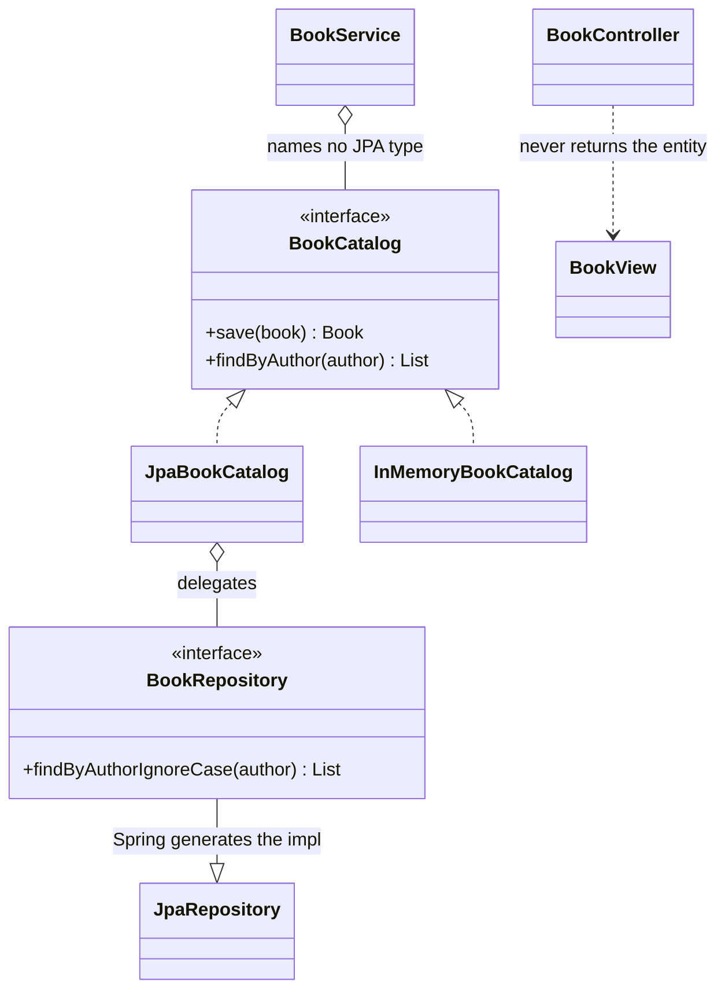

# Repository

**Category:** Spring idiom
**Package:** `com.example.designpatterns.spring.repository`

## Intent

Mediate between the domain and data-mapping layers using a collection-like interface
for accessing domain objects.

## The problem it solves

Without it, persistence leaks upward. Service code holds `EntityManager`s, writes
JPQL, and knows about transactions and flush modes. That code cannot be unit tested
without a database, and swapping the storage means rewriting the services.

The repository is an interface expressed in the *domain's* language:

```java
public interface BookCatalog {
    Book save(Book book);
    List<Book> findByAuthor(String author);
    List<Book> findAll();
    long count();
}
```

`BookService` depends on that and nothing else. Whether it becomes SQL, an HTTP call,
or an `ArrayList` scan is invisible from there.

## The proof the abstraction is real

The key artifact in this package is `BookCatalogContractTest` — an abstract test
class that both implementations must satisfy:

```java
abstract class BookCatalogContractTest {
    protected abstract BookCatalog catalog();

    @Test void lookupByAuthorIsCaseInsensitive() { ... }
    @Test void anUnknownAuthorYieldsAnEmptyListNotNull() { ... }
}
```

`InMemoryBookCatalogTest` runs it against a hand-written `ArrayList` implementation.
`JpaBookCatalogTest` runs the identical tests against H2 through Spring Data. Both
pass. That is what makes `BookCatalog` an abstraction rather than decoration — an
interface with exactly one possible implementation is just a longer class name.

> **A trap worth knowing.** Spring resolves a test's `@Transactional` rollback rule
> from the **declaring class of the test method**, not from the class being run. An
> abstract contract-test base without `@Transactional` means inherited methods execute
> outside a transaction — no rollback, and silent cross-test pollution. That is why
> the annotation is on `BookCatalogContractTest` itself, with a comment saying so.

## Structure



## Participants

| Role | Type | Location |
|---|---|---|
| Repository interface | `BookCatalog` | `src/main/java/com/example/designpatterns/spring/repository/BookCatalog.java` |
| Spring Data repository | `BookRepository` | `src/main/java/com/example/designpatterns/spring/repository/BookRepository.java` |
| Implementations | `JpaBookCatalog`, `InMemoryBookCatalog` | `src/main/java/com/example/designpatterns/spring/repository/` |
| Entity | `Book` | `src/main/java/com/example/designpatterns/spring/repository/Book.java` |
| API shape | `BookView` (record) | `src/main/java/com/example/designpatterns/spring/repository/BookView.java` |
| Domain service | `BookService` | `src/main/java/com/example/designpatterns/spring/repository/BookService.java` |

## What Spring Data actually does

`BookRepository` has **no implementation you ever write**. At startup Spring Data
generates a proxy and *parses the method name* — `findByAuthorIgnoreCase` becomes
`WHERE UPPER(author) = UPPER(?)`. That is Repository + Proxy + a little Interpreter,
and it is why hand-written DAO layers largely disappeared.

`JpaBookCatalogTest.springDataDerivedTheQueryFromTheMethodNameAlone` asserts the
interface declares exactly one method and is still an interface — nothing was
implemented by hand.

## Trade-offs — and when NOT to use it

- **The query lives in a method name.** A typo is a startup failure rather than a
  compile error, and the names get long fast
  (`findByAuthorIgnoreCaseAndPublishedYearGreaterThanOrderByTitleAsc`). Past a
  certain point, `@Query` is clearer.
- **`JpaRepository` leaks a lot of surface.** Extending it hands every caller
  `deleteAll()`, `flush()`, pageable `findAll` and more. That is why `BookCatalog`
  exists here: the domain sees four methods, not forty.
- **The abstraction is leaky where it matters.** Lazy loading, N+1 queries, flush
  timing and transaction boundaries all leak through. Pretending the storage is
  invisible is how you get a 300-query page load.
- **Generic repositories can hide the aggregate.** A repository per table, rather
  than per aggregate root, recreates the coupling you were avoiding.

**Don't use an extra interface** like `BookCatalog` in a small application where
`JpaRepository` alone is fine. It earns its keep when you want a fast in-memory
double, or a domain-shaped surface, or genuine storage independence.

## Try it

```bash
curl -s localhost:8080/api/patterns/repository | jq
curl -s 'localhost:8080/api/patterns/repository/books?author=ursula%20k.%20le%20guin' | jq

# the H2 console, for poking at the seeded data
open http://localhost:8080/h2-console      # JDBC URL: jdbc:h2:mem:patterns
```

Note the demo returns the same result set from both implementations — one from H2,
one from an `ArrayList`.
