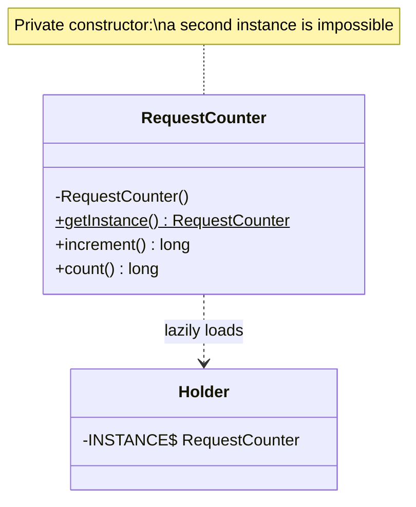

# Singleton

**Category:** Creational
**Package:** `com.example.designpatterns.creational.singleton`

## Intent

Ensure a class has only one instance, and provide a global point of access to it.

## The problem it solves

Some things genuinely should exist once per process: a connection pool, a metrics
registry, a configuration cache. Constructing them repeatedly is wasteful, and two
copies of "the" counter is simply a bug.

The naive fix is a `public static` field. Singleton adds two things: the
constructor is private, so a second instance is *impossible* rather than merely
discouraged; and creation can be deferred until first use.

The version here uses the **initialization-on-demand holder** idiom:

```java
private static final class Holder {
    private static final RequestCounter INSTANCE = new RequestCounter();
}
public static RequestCounter getInstance() { return Holder.INSTANCE; }
```

`Holder` is not loaded until `getInstance()` is first called, and the JVM
guarantees class initialization happens exactly once, under its own lock. You get
lazy creation and thread safety with no `synchronized` on the hot path — no
double-checked locking, no `volatile`, no contention.

## Structure



## Participants

| Role | Type | Location |
|---|---|---|
| Singleton | `RequestCounter` | `src/main/java/com/example/designpatterns/creational/singleton/RequestCounter.java` |
| Lazy holder | `RequestCounter.Holder` | same file |
| Container-managed equivalent | `CounterBean` | `src/main/java/com/example/designpatterns/creational/singleton/CounterBean.java` |
| Catalog entry | `SingletonDemo` | `src/main/java/com/example/designpatterns/creational/singleton/SingletonDemo.java` |

## Trade-offs — and when NOT to use it

Singleton is the most overused pattern in the catalogue, and the criticism is
deserved:

- **It is global mutable state.** Any code anywhere can reach it and change it.
  That makes call sites impossible to reason about in isolation.
- **It destroys testability.** State survives between tests in the same JVM.
  `SingletonTest` has to assert *deltas* (`count() == before + 3`) rather than
  absolutes, precisely because of this — read that test as a warning label.
- **The dependency is invisible.** A class using `RequestCounter.getInstance()`
  has a dependency that appears in no constructor and no signature.
- **You cannot substitute it.** No test double, no per-tenant variant, no
  alternative implementation.

**Don't use it** when what you actually want is "one instance in this
application" — that is a *lifecycle* requirement, and a DI container expresses it
better. Reach for the classic form only when the single instance must be reachable
from code the container does not manage.

## Where Spring uses this internally

Spring's answer is to make single-instance-ness a property of the container rather
than of your class. The default bean scope is `singleton`: one instance per
`ApplicationContext`.

The difference is not cosmetic. `CounterBean` has a public constructor and can be
built with `new` in a unit test (`SingletonSpringTest` does exactly that). You get
the one-instance benefit and keep substitutability. Note the scope is **per
context, not per JVM** — two contexts in one JVM, which is what every `@SpringBootTest`
class can create, means two instances.

See also `ApplicationContext#getBean`, and `@Scope("singleton")`.

## Try it

```bash
curl -s localhost:8080/api/patterns/singleton | jq
```

Call it twice and watch both counts rise — that is the state persistence, and the
testability problem, in one output.
