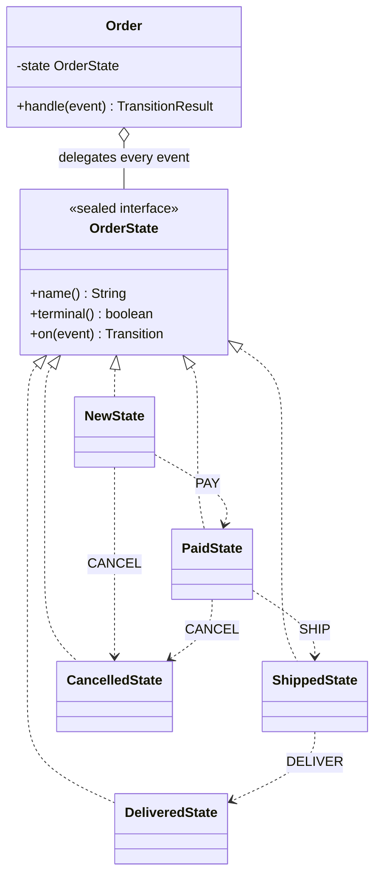

# State

**Category:** Behavioral
**Package:** `com.example.designpatterns.behavioral.state`

## Intent

Allow an object to alter its behaviour when its internal state changes. The object
will appear to change its class.

## The problem it solves

An order moves NEW → PAID → SHIPPED → DELIVERED, and may be cancelled — but only
sometimes. Written with a status field, every operation re-derives the rules:

```java
public void cancel() {
    if (status == DELIVERED) throw new IllegalStateException("already delivered");
    if (status == CANCELLED) throw new IllegalStateException("already cancelled");
    if (status == SHIPPED)   throw new IllegalStateException("already shipped");
    status = CANCELLED;
}
public void ship() {
    if (status != PAID) throw new IllegalStateException("not paid");
    ...
}     // and pay(), and deliver(), each with its own copy of the rules
```

The transition rules are smeared across every method. Adding a state (ON_HOLD) means
finding and correctly editing every one of them, and missing one produces a bug that
only appears for a specific sequence of events.

State inverts the layout: **one class per state**, each owning the transitions legal
*from* it. Adding a state adds a class; it cannot break the others because it does
not touch them.

The context ends up with no rules at all:

```java
public TransitionResult handle(OrderEventType event) {
    OrderState.Transition transition = state.on(event);   // the state decides
    if (!transition.accepted()) return new TransitionResult(false, from, from, transition.reason());
    state = transition.next();
    ...
}
```

No `if`, no `switch` over status.

## The transition table

|  | PAY | SHIP | DELIVER | CANCEL |
|---|:---:|:---:|:---:|:---:|
| **NEW** | → PAID | ✗ | ✗ | → CANCELLED |
| **PAID** | ✗ | → SHIPPED | ✗ | → CANCELLED |
| **SHIPPED** | ✗ | ✗ | → DELIVERED | ✗ |
| **DELIVERED** | ✗ | ✗ | ✗ | ✗ |
| **CANCELLED** | ✗ | ✗ | ✗ | ✗ |

Cancellation stops being legal once goods are with the carrier: at that point
cancelling is a *returns process*, not a state transition. Modelling it as a refusal
keeps the machine honest about what the business can actually do.

## Design decision: refuse by returning, not by throwing

An illegal transition returns `TransitionResult(accepted=false, …)` with a reason,
and leaves the state untouched. It does not throw.

"You cannot cancel a shipped order" is a business answer a user needs to see, not an
exceptional condition. Throwing would force a `try`/`catch` around routine control
flow at every call site. `StateTest.aRefusedTransitionLeavesTheStateExactlyAsItWas`
asserts the state object is `isSameAs` what it was, and the history unchanged — a
refusal must not corrupt anything.

## Structure



## Participants

| Role | Type | Location |
|---|---|---|
| State | `OrderState` (sealed) | `src/main/java/com/example/designpatterns/behavioral/state/OrderState.java` |
| Concrete States | `NewState`, `PaidState`, `ShippedState`, `DeliveredState`, `CancelledState` | `src/main/java/com/example/designpatterns/behavioral/state/` |
| Context | `Order` | `src/main/java/com/example/designpatterns/behavioral/state/Order.java` |
| Result | `TransitionResult` (record) | `src/main/java/com/example/designpatterns/behavioral/state/TransitionResult.java` |

## Why `sealed`, and a Java version caveat

`sealed` closes the set of states: the compiler knows there are exactly five, and no
code outside this package can add a sixth. `StateTest.theStateSetIsClosed` asserts
`getPermittedSubclasses()` has length 5.

**On Java 21+** sealing additionally makes a `switch` over an `OrderState` exhaustive
with no `default` branch — add a state and every such `switch` stops compiling until
you handle it. That is the strongest version of this pattern.

**This project targets Java 17**, where pattern matching for `switch` was still a
preview feature. Sealing here documents and enforces the closed hierarchy, but the
exhaustive-switch benefit is not available. (The `switch` statements inside each
state class compile fine — they switch over the `OrderEventType` *enum*, not over the
sealed type.)

Each state is stateless, so each is a singleton (`NewState.INSTANCE`). That is safe
precisely because they hold no data — contrast the warnings in `docs/patterns/singleton.md`.

## Trade-offs — and when NOT to use it

- **Class explosion.** Five states is five classes for what a two-line `enum` almost
  covers.
- **The transition graph is nowhere visible.** It is distributed across five files,
  so "what can happen from PAID?" is easy but "draw me the whole machine" requires
  reading all of them. The table above exists for that reason and can go stale.
- **States must reference each other**, so the classes are mutually coupled by
  construction.

**Don't use it** for a two-state flag — that is a `boolean`. And do not use it when
behaviour does not actually vary by state; if only the *label* changes, an `enum`
with a field is enough. For genuinely large machines, a dedicated library (Spring
Statemachine) buys you persistence, guards and visualisation.

## Try it

```bash
curl -s -X POST 'localhost:8080/api/patterns/state/replay?events=PAY,SHIP,DELIVER' | jq
curl -s -X POST 'localhost:8080/api/patterns/state/replay?events=PAY,SHIP,CANCEL' | jq
```

The second refuses the cancel, reports why, and leaves the order in SHIPPED.
