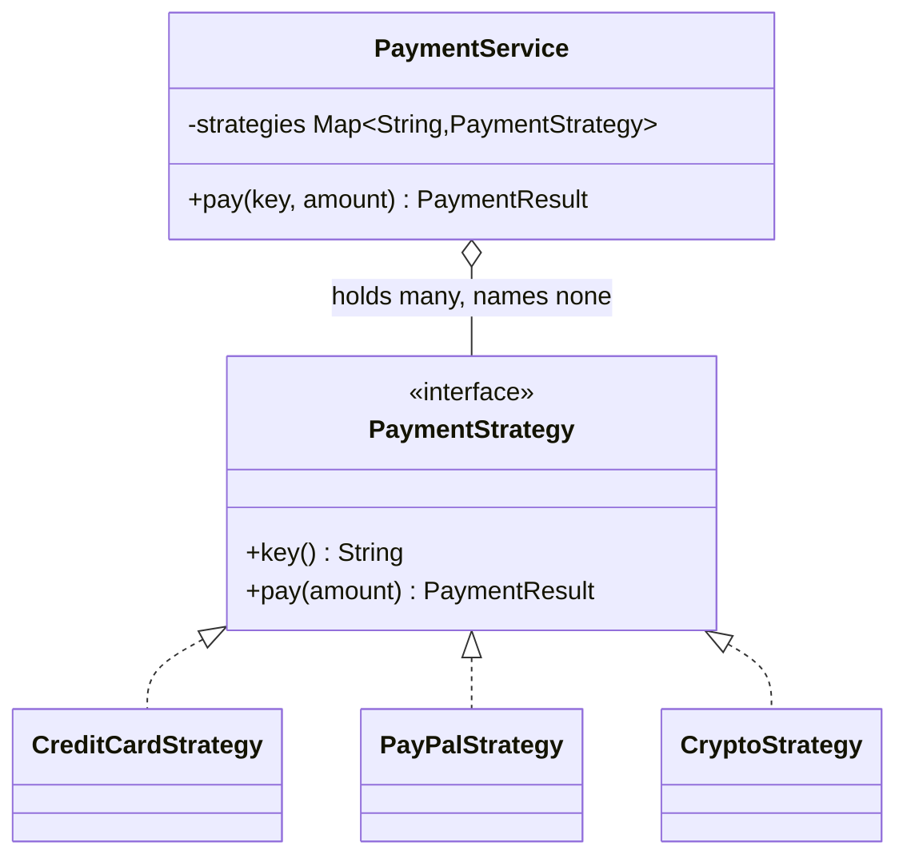

# Strategy

**Category:** Behavioral
**Package:** `com.example.designpatterns.behavioral.strategy`

## Intent

Define a family of algorithms, encapsulate each one, and make them interchangeable.
Strategy lets the algorithm vary independently of the clients that use it.

## The problem it solves

Payment fees differ per rail. Written directly, the service grows a branch per rail:

```java
public BigDecimal fee(String method, BigDecimal amount) {
    if (method.equals("card"))   return amount.multiply(new BigDecimal("0.029")).add(...);
    if (method.equals("paypal")) return amount.multiply(new BigDecimal("0.034")).add(...);
    if (method.equals("crypto")) return amount.multiply(new BigDecimal("0.01"));
    throw new IllegalArgumentException(method);
}     // + a new branch every quarter, and every change re-tests every rail
```

Every rail's rules live in one method, so a change to PayPal risks card payments,
and the method is re-tested in full for each addition.

Strategy gives each algorithm its own class and lets the context pick one:

```java
public PaymentService(List<PaymentStrategy> availableStrategies) {   // Spring injects ALL of them
    this.strategies = availableStrategies.stream()
        .collect(toMap(PaymentStrategy::key, identity(), ...));
}
```

**Adding a rail is one new `@Component` and zero edits.** That is not a claim, it is
`StrategyTest.addingAStrategyRequiresNoChangeToTheContextOrToExistingStrategies` —
which registers a brand-new strategy and finds it immediately selectable.

## Structure



## Participants

| Role | Type | Location |
|---|---|---|
| Strategy | `PaymentStrategy` | `src/main/java/com/example/designpatterns/behavioral/strategy/PaymentStrategy.java` |
| Concrete Strategies | `CreditCardStrategy`, `PayPalStrategy`, `CryptoStrategy` | `src/main/java/com/example/designpatterns/behavioral/strategy/` |
| Context | `PaymentService` | `src/main/java/com/example/designpatterns/behavioral/strategy/PaymentService.java` |
| Result | `PaymentResult` (record) | `src/main/java/com/example/designpatterns/behavioral/strategy/PaymentResult.java` |

## Design decision: what happens when no strategy matches

This project chose **fail fast**:

```java
PaymentStrategy strategy = strategies.get(key);
if (strategy == null) {
    throw new IllegalArgumentException(
        "Unknown payment method '" + key + "'. Available: " + strategies.keySet());
}
```

The alternatives, and why they were rejected:

| Option | Cost |
|---|---|
| Fall back to a default strategy | A typo like `"papyal"` silently charges a card and reports success. Invisible until the finance report. |
| Return an unsuccessful result | Uniform return type, but every caller must remember to check a flag — and the one that forgets treats failure as success. |

An unrecognised key is a configuration or programming error, not a business
outcome, so it throws. `CatalogExceptionHandler` maps it to a 400 with the list of
valid methods, so the error teaches rather than merely refuses.

## Trade-offs — and when NOT to use it

- **Class count.** Three fee formulas become three classes plus an interface. Below
  two or three strategies this is heavier than an `if`.
- **The caller must know which strategy to pick.** Strategy relocates the choice; it
  does not remove it.
- **A shared interface constrains all of them.** If one rail needs an extra
  parameter, either every strategy's signature grows or you smuggle it through a
  parameter object.

**Don't use it** when the algorithms are one-liners with no prospect of growth, or
when the variation is data rather than behaviour — a `Map<String, BigDecimal>` of fee
rates would beat three classes here if the *formula* never varied.

## Strategy vs. State

Nearly identical structure, different intent. Strategies are chosen **by the
client** and do not know about each other. States are chosen **by the object
itself** and each knows its legal successors. Compare `PaymentService.pay` with
`Order.handle`.

## Where Spring uses this internally

Injecting `Map<String, PaymentStrategy>` or `List<PaymentStrategy>` is the idiomatic
Spring form of this pattern, and the container does the assembly. `@Qualifier` picks
one when injecting a single implementation. Internally, Spring's
`PlatformTransactionManager`, `CacheManager`, `PasswordEncoder`, `ViewResolver` and
`HandlerMapping` are all strategy interfaces with pluggable implementations.

## Try it

```bash
curl -s localhost:8080/api/patterns/strategy | jq

curl -s -X POST 'localhost:8080/api/patterns/strategy/pay?method=paypal&amount=100.00' | jq
curl -s -X POST 'localhost:8080/api/patterns/strategy/pay?method=papyal&amount=100.00' | jq   # 400
```
