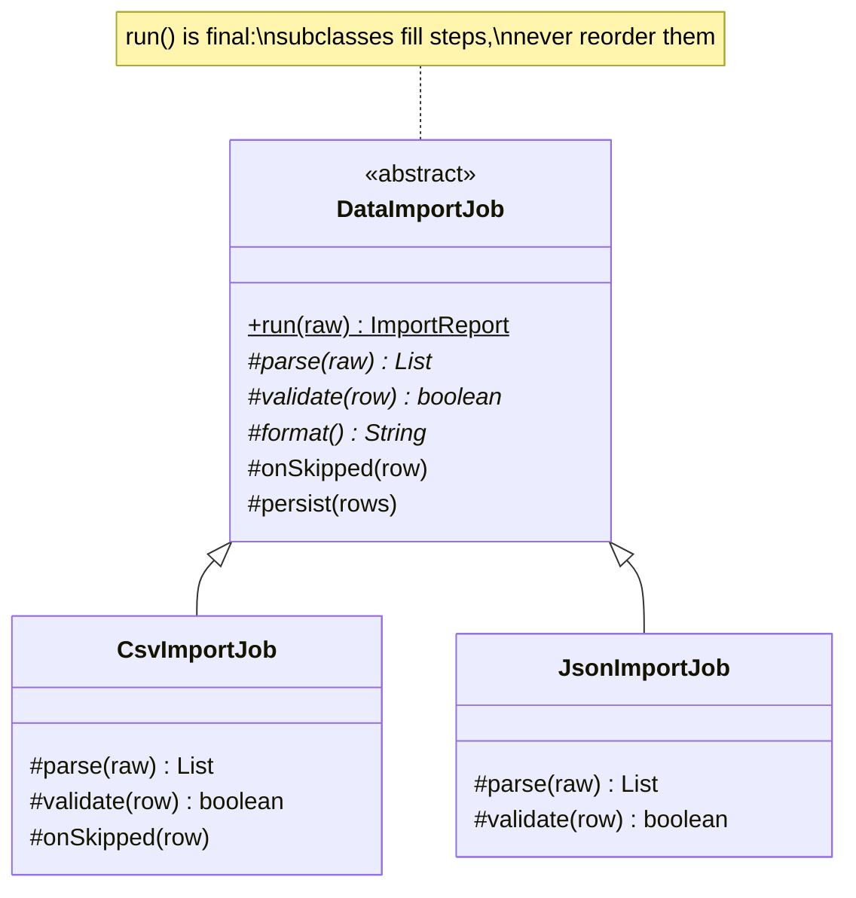

# Template Method

**Category:** Behavioral
**Package:** `com.example.designpatterns.behavioral.templatemethod`

## Intent

Define the skeleton of an algorithm in an operation, deferring some steps to
subclasses. Template Method lets subclasses redefine certain steps of an algorithm
without changing the algorithm's structure.

## The problem it solves

Importing CSV and importing JSON differ only in *parsing* and *validation*. The
surrounding shape — parse, validate each row, persist the survivors, summarise — is
identical, and it must stay identical. Copy-pasting the skeleton into each importer
means a fix to the persist step must be applied twice, and one day will not be.

Template Method puts the skeleton in the base class and makes it **`final`**:

```java
public final ImportReport run(String raw) {
    List<Map<String,String>> rows = parse(raw);          // varies
    for (Map<String,String> row : rows) {
        if (validate(row)) valid.add(row);               // varies
        else { skipped++; onSkipped(row); }              // optional hook
    }
    persist(valid);                                      // shared
    return new ImportReport(format(), rows.size(), valid.size(), skipped, steps);
}
```

**That `final` is the whole pattern.** Without it you have ordinary inheritance and
no guarantee at all — a subclass could reorder the steps, skip validation, or persist
before validating, and nothing would notice. `TemplateMethodTest.aSubclassCannotReorderTheAlgorithm`
asserts the modifier reflectively, because the contract is worth a test.

## Hooks vs. abstract steps

Two kinds of extension point, and the difference matters:

- **Abstract step** (`parse`, `validate`) — the subclass *must* supply it. The
  compiler enforces it.
- **Hook** (`onSkipped`) — an empty default the subclass *may* override. Subclasses
  that do not care pay nothing.

## Structure



## Participants

| Role | Type | Location |
|---|---|---|
| Abstract Class | `DataImportJob` | `src/main/java/com/example/designpatterns/behavioral/templatemethod/DataImportJob.java` |
| Concrete Classes | `CsvImportJob`, `JsonImportJob` | `src/main/java/com/example/designpatterns/behavioral/templatemethod/` |
| Result | `ImportReport` (record) | `src/main/java/com/example/designpatterns/behavioral/templatemethod/ImportReport.java` |

## Trade-offs — and when NOT to use it

- **Inheritance is a hard coupling.** The subclass depends on the base class's
  protected surface, and changing that surface breaks every subclass. You get one
  superclass, so this axis of variation is spent.
- **The Hollywood Principle is disorienting.** "Don't call us, we'll call you" means
  reading a subclass tells you *what* varies but never *when* it runs. You must read
  the base class too.
- **Protected members are API.** Anything a subclass can see, you must keep working.

**Don't use it** when the varying steps are independent of each other — composing
Strategy objects gives you the same flexibility without spending your inheritance
slot, and lets steps be swapped at runtime rather than at compile time.

## Where Spring uses this internally

`JdbcTemplate` is the canonical example: Spring fixes acquire-connection → create
statement → **execute your callback** → map results → close everything → translate
exceptions, and you supply only the varying middle. Every resource leak and every
`SQLException` translation is handled once, correctly.

Also `RestTemplate`, `TransactionTemplate`, `AbstractApplicationContext.refresh()`
(a template method whose steps every context implementation fills in), and the
`AbstractController` hierarchy.

## Try it

```bash
curl -s localhost:8080/api/patterns/templatemethod | jq '.csv.steps, .json.steps, .stepsAreIdentical'
```

Two formats, one step sequence.
